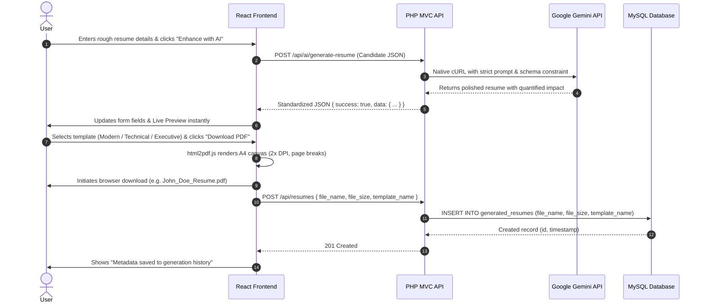

# AI-Powered Resume Builder & Generator (Full-Stack College Project)

> An enterprise-grade, full-stack AI Resume Generator built with **React 19**, **Three.js**, **GSAP**, **Core PHP 8.2 MVC (no frameworks)**, **MySQL (MariaDB)**, and the **Google Gemini API**. Features an interactive 3D landing page, modular multi-step resume builder, AI-driven professional enhancement, real-time A4 document previewing, client-side vector-grade PDF export, and a zero-PII privacy-preserving metadata history system.

---

## Table of Contents
1. [Project Overview](#project-overview)
2. [Architecture & System Design](#architecture--system-design)
3. [Key Features](#key-features)
4. [Tech Stack](#tech-stack)
5. [Zero-PII Privacy & Security Architecture](#zero-pii-privacy--security-architecture)
6. [Prerequisites & System Requirements](#prerequisites--system-requirements)
7. [Installation & Setup Guide](#installation--setup-guide)
   - [1. Database Configuration](#1-database-configuration)
   - [2. Backend Setup (Core PHP MVC)](#2-backend-setup-core-php-mvc)
   - [3. Frontend Setup (React + Vite)](#3-frontend-setup-react--vite)
8. [Google Gemini AI Configuration](#google-gemini-ai-configuration)
9. [REST API Documentation](#rest-api-documentation)
10. [Resume Templates](#resume-templates)
11. [PDF Export Architecture](#pdf-export-architecture)
12. [Testing & Verification](#testing--verification)
13. [Professor / Viva Evaluation Checklist](#professor--viva-evaluation-checklist)
14. [Troubleshooting Guide](#troubleshooting-guide)

---

## Project Overview

In today's competitive job market, candidates often struggle with crafting resumes that clearly communicate their achievements, pass Applicant Tracking Systems (ATS), and adhere to professional layout standards.

This project delivers an end-to-end web platform designed to solve these challenges:
- **Interactive 3D Experience:** A cinematic landing page powered by Three.js and GSAP smooth-scroll to engage users.
- **Structured Resume Builder:** A modular, clean form UI supporting personal information, professional summaries, work experience, education, skills, and target job descriptions.
- **Gemini AI Engine:** Uses Google Gemini (`gemini-3.1-flash-lite`) to transform raw inputs into polished, action-verb-oriented, ATS-optimized bullet points without hallucinating fake credentials.
- **Live A4 Preview & 3 Professional Templates:** Real-time responsive preview rendered exactly to international A4 print dimensions (`210mm x 297mm`).
- **Client-Side PDF Generation:** High-fidelity, multi-page vector-quality PDF export using `html2pdf.js` with smart CSS page-break algorithms.
- **Zero-PII Audit History:** Generates an audit log in MySQL capturing strictly generation metadata (`file_name`, `file_size`, `template_name`, `timestamp`) with zero personal data stored.

---

## Architecture & System Design

The system implements a decoupled client-server architecture:
- **Client:** Single Page Application (SPA) built with React 19 and Vite.
- **Backend:** Custom Model-View-Controller (MVC) server written in vanilla PHP 8.2 without third-party frameworks.
- **Database:** MariaDB / MySQL accessed exclusively via PDO prepared statements.
- **AI Service:** Outbound native cURL gateway to Google's Gemini REST API with IPv4 DNS optimization.

### Architecture Flowchart

```mermaid
flowchart TD
    subgraph Client["Frontend Client (React 19 + Vite)"]
        UI[Landing Page & 3D WebGL Scene]
        Builder[Modular Resume Builder Form]
        Preview[Live A4 Resume Preview]
        PDF[html2pdf.js PDF Exporter]
        History[Resume History Modal]
    end

    subgraph Backend["Core PHP 8.2 MVC Server"]
        Router["Front Controller (public/index.php & api.php)"]
        CORS["CorsMiddleware"]
        AICtrl["AIController"]
        ResumeCtrl["ResumeController"]
        GeminiSvc["GeminiService (cURL v4)"]
        ResumeModel["Resume Model (PDO)"]
    end

    subgraph External["External Cloud & Database"]
        GeminiAPI["Google Gemini API (gemini-3.1-flash-lite)"]
        MySQL[("MySQL / MariaDB (ai_resume_builder)")]
    end

    UI -->|Start Building| Builder
    Builder -->|Fill Data or Load Sample| Preview
    Builder -->|Enhance with AI| AICtrl
    AICtrl --> GeminiSvc
    GeminiSvc -->|Prompt + Anti-Hallucination| GeminiAPI
    GeminiAPI -->|Structured JSON| GeminiSvc
    GeminiSvc --> AICtrl
    AICtrl -->|Polished Resume JSON| Builder
    
    Preview -->|Download PDF| PDF
    PDF -->|Generate Blob & Save| BrowserDownload[A4 PDF File]
    PDF -->|Log Metadata (Zero PII)| ResumeCtrl
    ResumeCtrl --> ResumeModel
    ResumeModel -->|INSERT file_name, file_size, template| MySQL
    
    History -->|Fetch Past Exports| ResumeCtrl
    ResumeCtrl -->|SELECT id, file_name, timestamp| ResumeModel
    ResumeModel --> MySQL
```

### End-to-End Sequence Diagram



---

## Key Features

1. **3D Interactive Visuals:** Three.js network constellation background with GSAP timeline animations and smooth inertial scrolling via Lenis.
2. **Modular Form Architecture:** Clean, decoupled React components for Personal Info, Education, Experience, Skills, and Target Job Description with reusable inputs.
3. **One-Click Sample Data:** Instantly populate the builder with complete sample data to test and demonstrate templates without manual typing.
4. **Anti-Hallucination AI Enhancement:** AI enhancement leverages strict prompting rules:
   - Polishes phrasing and bullet points into active, metric-focused language (e.g., using the Google X-Y-Z formula: *"Accomplished [X] as measured by [Y] by doing [Z]"*).
   - Never invents companies, dates, degrees, or certifications that the user did not provide.
   - Tailors keywords to match the user's provided target job description.
5. **Three Professional Templates:**
   - **Modern Minimalist:** Clean typography, left accent bar, balanced spacing.
   - **Technical Depth:** Dense two-column grid engineered for Software Engineers and Data Scientists.
   - **Executive Signal:** Sophisticated header, serif typography, high-impact leadership summary.
6. **Print-Perfect A4 PDF:** Matches ISO 216 dimensions (`210mm x 297mm`) with responsive zoom, page-break boundary enforcement, and 2x canvas scaling.
7. **Audit History Dashboard:** View previously generated resume metadata, download stats, template choices, and delete records anytime.

---

## Tech Stack

### Frontend
- **Framework:** React 19
- **Build Tool:** Vite 8
- **Styling:** Vanilla CSS, CSS Grid, Flexbox, Material UI icons (`@mui/icons-material`)
- **3D & Animation:** Three.js, GSAP (GreenSock), `@studio-freight/lenis` smooth scroll
- **PDF Engine:** `html2pdf.js` (Canvas + jsPDF)

### Backend
- **Language:** Core PHP 8.2 (Vanilla, 0 frameworks, 0 composer dependencies)
- **Architecture:** MVC (Model-View-Controller)
- **Database Driver:** PHP Data Objects (PDO) with prepared statements (`ATTR_EMULATE_PREPARES => false`)
- **Network Engine:** Native PHP cURL with IPv4 forced resolution (`CURLOPT_IPRESOLVE => CURL_IPRESOLVE_V4`)
- **Environment Management:** Custom lightweight `.env` parser (`server/app/utils/Env.php`)

### Database
- **Engine:** MySQL 8.0+ / MariaDB 10.4+ (XAMPP standard)
- **Collation:** `utf8mb4_unicode_ci`

### AI Provider
- **Model:** Google Gemini (`gemini-3.1-flash-lite`) via Google Generative AI REST API v1beta

---

## Zero-PII Privacy & Security Architecture

This project strictly adheres to **Zero Personally Identifiable Information (PII) Storage**:
- **Where does resume data live?** Candidate personal data (names, emails, phone numbers, addresses, education, job histories) exists **only** in the client's React memory state while crafting the resume.
- **What is sent to Gemini?** Only the active resume text to be polished. No data is stored or retained on the server.
- **What is saved in MySQL?** When a PDF is downloaded, the client sends only anonymous file generation metadata:
  ```json
  {
    "file_name": "Alex_Vance_Resume.pdf",
    "file_size": 184520,
    "template_name": "modern"
  }
  ```
- **MySQL Table Structure:**
  ```sql
  CREATE TABLE generated_resumes (
      id INT AUTO_INCREMENT PRIMARY KEY,
      file_name VARCHAR(255) NOT NULL,
      file_size INT UNSIGNED NOT NULL,
      template_name VARCHAR(50) NOT NULL,
      generation_timestamp TIMESTAMP DEFAULT CURRENT_TIMESTAMP,
      INDEX idx_timestamp (generation_timestamp)
  );
  ```
- **Security Protections:**
  - `server/.env` is ignored by Git to prevent API key leaks.
  - SQL Injection is prevented through 100% parameterized PDO queries.
  - Strict Cross-Origin Resource Sharing (CORS) preflight validation.
  - Payload size validation (limits incoming JSON to 2MB).

---

## Prerequisites & System Requirements

Ensure the following tools are installed on your machine:
- **XAMPP** (or standalone Apache + MySQL + PHP 8.1+):
  - PHP 8.1 or higher (PHP 8.2 recommended).
  - MySQL / MariaDB running on port 3306.
  - PHP extensions enabled in `php.ini`: `extension=pdo_mysql`, `extension=curl`, `extension=mbstring`, `extension=openssl`.
- **Node.js**: v18.0.0 or higher (v20+ recommended).
- **npm**: v9.0.0 or higher.
- **Google Gemini API Key**: Free API key from [Google AI Studio](https://aistudio.google.com/).

---

## Installation & Setup Guide

### 1. Database Configuration

1. Launch **XAMPP Control Panel** and start **MySQL** (and **Apache** if using Apache).
2. Open your terminal or phpMyAdmin (`http://localhost/phpmyadmin`).
3. Import the database schema located at `server/database/schema.sql`:
   ```powershell
   # Using MySQL CLI in PowerShell:
   Get-Content server/database/schema.sql -Raw | C:\xampp\mysql\bin\mysql.exe -u root
   ```
   *Or paste the contents of `server/database/schema.sql` into phpMyAdmin SQL console.*
4. This creates the database `ai_resume_builder` and the table `generated_resumes`.

---

### 2. Backend Setup (Core PHP MVC)

1. Navigate to the `server/` directory:
   ```bash
   cd server
   ```
2. Copy the sample environment file to `.env`:
   ```bash
   cp .env.example .env
   ```
3. Open `.env` and fill in your database credentials and Gemini API Key:
   ```env
   # Database Configuration
   DB_HOST=127.0.0.1
   DB_PORT=3306
   DB_DATABASE=ai_resume_builder
   DB_USERNAME=root
   DB_PASSWORD=

   # Google Gemini API Configuration
   GEMINI_API_KEY=YOUR_GEMINI_API_KEY_HERE
   GEMINI_MODEL=gemini-3.1-flash-lite

   # Application Configuration
   APP_ENV=development
   ALLOWED_ORIGINS=http://localhost:5173,http://127.0.0.1:5173
   ```

4. **Run the Backend Server**:
   You have two simple options:

   - **Option A (PHP Built-in Server - Recommended for Fast Testing):**
     Run from the repository root:
     ```powershell
     C:\xampp\php\php.exe -S 127.0.0.1:8000 -t server/public
     ```
     Verify health in your browser: `http://127.0.0.1:8000/api/health`

   - **Option B (XAMPP Apache):**
     If the project is inside `C:\xampp\htdocs\myResumeIsCooked`, ensure Apache is started in XAMPP.
     Verify health: `http://localhost/myResumeIsCooked/server/public/api/health`

---

### 3. Frontend Setup (React + Vite)

1. Open a new terminal and navigate to `client/`:
   ```bash
   cd client
   ```
2. Install the frontend dependencies:
   ```bash
   npm install
   ```
3. Start the Vite development server:
   ```bash
   npm run dev
   ```
4. Open your browser at:
   ```
   http://localhost:5173
   ```

---

## Google Gemini AI Configuration

The backend connects directly to Google Generative Language REST API v1beta.
- **Default Recommended Model:** `gemini-3.1-flash-lite` (Fastest response time, highly reliable quota, excellent structured JSON compliance).
- **Prompt Architecture (`server/app/services/GeminiService.php`):**
  - Uses system instructions commanding the AI to act as an elite technical recruiter and professional resume writer.
  - Injects target job descriptions to extract high-relevance ATS keywords.
  - Enforces strict anti-hallucination rules: dates, institutions, company names, and degrees are preserved with 100% fidelity.
  - Returns raw, parseable JSON conforming to the application schema.
- **cURL Connection Reliability:** Windows cURL includes `CURLOPT_IPRESOLVE => CURL_IPRESOLVE_V4` to avoid IPv6 timeout penalties.

---

## REST API Documentation

Base URL: `http://localhost/myResumeIsCooked/server/public` or `http://127.0.0.1:8000`

### 1. Health Check
- **`GET /api/health`**
- **Description:** Verifies server runtime, PHP version, and database connectivity.
- **Response (200 OK):**
  ```json
  {
    "success": true,
    "data": {
      "status": "healthy",
      "php_version": "8.2.12",
      "database": {
        "status": "connected",
        "driver": "mysql"
      },
      "timestamp": "2026-11-18 00:15:00"
    }
  }
  ```

### 2. List Resume Metadata
- **`GET /api/resumes?limit=20&offset=0`**
- **Description:** Returns the paginated list of exported resume records (Zero PII).
- **Response (200 OK):**
  ```json
  {
    "success": true,
    "data": [
      {
        "id": 1,
        "file_name": "Alex_Vance_Resume.pdf",
        "file_size": 184520,
        "template_name": "modern",
        "generation_timestamp": "2026-11-18 00:12:00"
      }
    ]
  }
  ```

### 3. Record Resume Metadata
- **`POST /api/resumes`**
- **Description:** Stores file size and template name upon successful client PDF download.
- **Request Body:**
  ```json
  {
    "file_name": "Alex_Vance_Resume.pdf",
    "file_size": 184520,
    "template_name": "modern"
  }
  ```
- **Response (201 Created):**
  ```json
  {
    "success": true,
    "message": "Resume metadata logged successfully",
    "data": {
      "id": 2
    }
  }
  ```

### 4. Delete Resume Metadata
- **`DELETE /api/resumes/{id}`**
- **Description:** Deletes a specific audit record by ID.
- **Response (200 OK):**
  ```json
  {
    "success": true,
    "message": "Resume record deleted successfully"
  }
  ```

### 5. AI Generate Resume
- **`POST /api/ai/generate-resume`**
- **Description:** Sends raw user resume fields and target job to Gemini to produce an ATS-optimized resume.
- **Request Body:** Full candidate JSON payload (`personalInfo`, `summary`, `experience`, `education`, `skills`, `targetJob`).
- **Response (200 OK):** Standardized JSON containing polished resume fields matching the state schema.

---

## Resume Templates

The generator includes 3 distinct, professionally styled templates in `client/src/components/preview/templates/`:

1. **Modern Minimalist (`ModernMinimalTemplate.jsx`)**:
   - Modern slate blue header accents.
   - Clean iconography, spacious typography, balanced section borders.
   - Ideal for general corporate, creative, and consulting roles.
2. **Technical Depth (`TechnicalDepthTemplate.jsx`)**:
   - High information density, monospace accent headers (`JetBrains Mono`).
   - Grouped technical skill badges (Languages, Frameworks, Cloud, Tools).
   - Ideal for Software Engineers, DevOps, Systems Architects, and Data Scientists.
3. **Executive Signal (`ExecutiveSignalTemplate.jsx`)**:
   - Elegant Georgia serif header styling with authoritative rule lines.
   - Prominent leadership summary block and achievement-first bullet formatting.
   - Ideal for Product Managers, Directors, Founders, and Engineering Managers.

---

## PDF Export Architecture

Client-side PDF generation is handled by `client/src/utils/pdfExport.js` using `html2pdf.js`:
- **Dimensions:** Strict A4 portrait (`210mm x 297mm`).
- **Canvas Resolution:** `scale: 2` with `useCORS: true` for crisp, 300 DPI-equivalent vector text without blurry canvas downsampling.
- **Page Break Algorithm:** Automated CSS break-avoidance:
  ```css
  .resume-section-item, 
  .resume-section-title {
      page-break-inside: avoid !important;
      break-inside: avoid !important;
  }
  ```
- **File Sanitization:** Auto-formats downloaded filename to `FirstName_LastName_Resume.pdf` or `Resume_[timestamp].pdf`.

---

## Testing & Verification

A comprehensive 12-test automated suite is provided to verify security and integration:
```powershell
C:\xampp\php\php.exe scratch/test_step9_security_suite.php
```

### Test Coverage:
1. **Secret Exposure:** Confirms `.env` and `GEMINI_API_KEY` are never returned via HTTP endpoints.
2. **CORS Headers:** Validates `Access-Control-Allow-Origin` and `Access-Control-Allow-Methods` preflight response.
3. **Health Check:** Confirms PDO connectivity to MariaDB.
4. **CRUD Lifecycle:** Creates, reads, queries, and deletes metadata records.
5. **SQL Injection Resistance:** Attacks input fields with `' OR 1=1 --` strings to prove PDO parameter binding immune.
6. **Input Validation:** Confirms missing parameters yield HTTP 422 with actionable error messages.
7. **Gemini AI Integration:** Verifies JSON response schema, action verb generation, and keyword matching.
8. **Static Code Analysis:** OxLint verifies 0 errors and 0 warnings across 61 client files.
9. **Production Bundling:** Vite builds production assets in under 700ms.

---

## Professor / Viva Evaluation Checklist

Use this quick guide during your project presentation or lab viva:

| Question / Topic | Project Implementation & Proof Point |
| :--- | :--- |
| **Why Core PHP without Laravel?** | Demonstrates fundamental mastery of MVC architecture, request routing, Singleton PDO connections, and cURL networking without hiding behind framework boilerplate. |
| **How are SQL Injections prevented?** | 100% prepared statements via PDO with `PDO::ATTR_EMULATE_PREPARES => false`. No raw string concatenation exists in any SQL query. |
| **How is user privacy protected?** | Zero-PII storage policy. Personal data stays client-side in React state. Only anonymized file metadata (`file_name`, `file_size`, `template_name`) is logged in MySQL. |
| **Where is the Gemini API Key kept?** | Securely in `server/.env` on the server. The frontend has zero knowledge of the key; all requests route through the backend `AIController`. |
| **How does AI avoid hallucinating?** | The system prompt strictly constrains Gemini to the user's provided factual history, enhancing only rhetoric and metric presentation. |
| **How is the PDF generated?** | Client-side DOM-to-Canvas rendering via `html2pdf.js` calibrated to ISO A4 dimensions (`210mm x 297mm`) with page-break CSS prevention. |

---

## Troubleshooting Guide

### 1. MySQL Connection Error (`Access denied for user 'root'@'localhost'`)
- Ensure MySQL is running in XAMPP.
- Verify `server/.env` has `DB_PASSWORD=` empty (default XAMPP setup) or your custom password.
- Verify host is `127.0.0.1` instead of `localhost` to avoid Unix socket / named pipe issues.

### 2. Gemini API Returns 404 or Timeout
- Verify your API key in `server/.env`.
- Ensure `GEMINI_MODEL=gemini-3.1-flash-lite`.
- Check that your network connection allows outbound cURL HTTPS requests to `generativelanguage.googleapis.com`.

### 3. Frontend Cannot Connect to Backend (CORS Error)
- Check that your frontend URL (`http://localhost:5173` or `http://127.0.0.1:5173`) is listed in `ALLOWED_ORIGINS` in `server/.env`.
- Verify the backend API base URL in `client/src/services/api.js` points to your active server port.

---

## License

This project was developed for educational and academic submission purposes. Licensed under the [MIT License](LICENSE).
